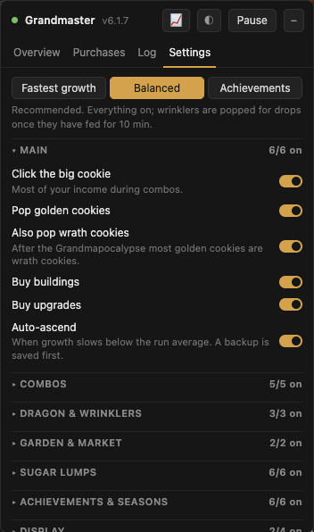

# 🍪 Cookie Clicker Grandmaster

A browser extension that plays [Cookie Clicker](https://orteil.dashnet.org/cookieclicker/) for you, with one goal: **unlock every achievement as fast as the game allows.**

Leave it running in a tab and it clicks, buys, casts spells, tends the garden, trades stocks, hunts achievements and ascends when it's worth it. A small panel shows what it's doing and logs everything it buys.

  
  
  

## Install (2 minutes)

1. Download **[cookie-clicker-grandmaster.zip](https://github.com/exexexexe/cookie-clicker-grandmaster/releases/latest/download/cookie-clicker-grandmaster.zip)** from the latest release.
   (Not the green *Code → Download ZIP* button: that one wraps everything in an extra folder.)

**Firefox (recommended)**

2. Type `about:debugging#/runtime/this-firefox` in the address bar.
3. Click **Load Temporary Add-on…** and pick the ZIP you just downloaded. No need to unzip.
4. Open [Cookie Clicker](https://orteil.dashnet.org/cookieclicker/). The panel appears in the bottom-left corner.

> Firefox removes temporary add-ons when you close it, so you'll redo step 2–3 after a restart.

**Chrome / Edge / Brave**

2. Unzip the download.
3. Go to `chrome://extensions`, switch on **Developer mode** (top right).
4. Click **Load unpacked** and pick the unzipped folder. (A warning about `browser_specific_settings` is harmless.)

## Before you start

- **Back up your save.** In the game: Options → *Export save*, and paste it somewhere safe. The bot also keeps its own backups (Settings → *Backup now*).
- **It will ascend for you.** That resets your run (as ascending always does) when it decides it's worth it. Don't want that? Turn off *Auto-ascend* in Settings.
- **Press F8** any time to pause or resume everything.
- **Pick a preset** in Settings: *Balanced* (recommended, the default), *Fastest growth* (never pops wrinklers for seasonal drops) or *Achievements* (drops and count achievements as fast as possible).

## What it does

- **Clicks** the big cookie and every golden cookie and reindeer.
- **Buys** the building or upgrade that pays for itself fastest, and keeps a cookie reserve so golden cookies pay out big.
- **Sugar lumps:** times each harvest so your next lump is usually a **golden** one (2–7 lumps instead of 1), and spends lumps in the order that gets 100% soonest.
- **Godzamok combo:** sells cheap buildings and buys them right back for a big click boost, especially during Click frenzies.
- **Grimoire:** predicts Force the Hand of Fate two casts ahead, skips bad outcomes, and double-casts when both are good.
- **Pantheon and dragon:** picks gods and auras with the game's own numbers, trains the dragon to the second aura mid-run when it pays, and swaps auras during click buffs.
- **Garden and stock market:** breeds every seed, and trades stocks with rules tested on the game's own market code.
- **Grandmapocalypse:** researches it every run, keeps wrinklers as income, and does the one-time Elder Pledge and Moistburster runs for their achievements.
- **Achievement hunting:** dozens of one-off achievements (hidden clicks, the madeleine, gift codes, wrinkler poking, seasons, stock-market and Lucky-number achievements…).
- **Ascends** when your progress starts slowing down, finishes what's worth finishing first, and spends your leftover cookies on achievements.
- **Keeps itself in check:** if a feature makes CpS drop by more than 10% twice, it switches that feature off and tells you.

## The panel

| Tab | What's in it |
|---|---|
| **Overview** | What it's doing right now, achievement progress, and the few things only you can do |
| **Purchases** | Everything it bought, with filters and *Export CSV* |
| **Log** | A running diary of its actions |
| **Settings** | Presets (Fastest growth / Balanced / Achievements), then any feature on or off. A ★ marks what you changed; *Reset to recommended* undoes it |
| **📈 Graphs** (F10) | CpS, prestige, achievements, lumps and bank over 1 h to all time |
| **◐ Black screen** (F9) | Hides the game's flashing; the bot keeps playing underneath |

## A few achievements need you

The bot can't do these, but the panel reminds you:

- **Cookie-dunker**: make the browser window short until the cookie dips into the milk.
- **Stifling the press**: make the window very narrow, then click the news ticker.
- **Baby it's old outside**: at Christmas, click one of the elf grandmas.

## FAQ

**How long until 100%?** Months. Some achievements are tied to real time (sugar lumps, garden growth, seasons). The bot makes those as fast as possible, but it can't skip them.

**Is this cheating?** It plays the way a very patient, very fast human would: it clicks, buys and times things. It never edits your save or grants achievements directly. Whether that counts as cheating is up to you. 🙂

**Can I leave it in a background tab?** Yes. It keeps the game running at full speed when the tab is hidden (Settings → Display).

**Will it mess up my save?** It saves a backup every 10 minutes and before every ascension. Restore the latest one by typing `CCA.restore()` in the browser console (F12).

**Does it work on the Steam version?** No, only the web version at orteil.dashnet.org.

**Something stopped working after a game update?** Type `CCA.diag()` in the console (F12) and open an issue with the output.

---

Curious how it works under the hood? See [HOW-IT-WORKS.md](HOW-IT-WORKS.md). Test notes are in [TESTING.md](TESTING.md).
